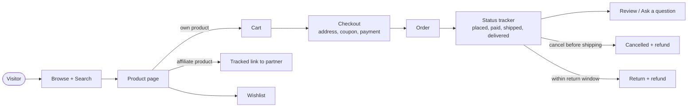

# 01 Product overview

## What it is

A complete online store that works in two ways at once:

1. **Your own products** — shoppers add them to a cart, pay (cash on delivery or online), and you ship them. Stock, invoices, returns and refunds are handled by the system.
2. **Affiliate products** — products from partner marketplaces. Shoppers see them in your catalogue with clear disclosure and are sent to the partner to buy; you see how many clicks each product earned.

Both kinds sit side by side, search the same way, and are managed from the same admin area.

## The big picture

## Who uses it

| Person | Uses | To |
|---|---|---|
| Shopper (guest or customer) | The storefront | Find, compare, buy, track, return, review |
| Team member | Only the parts of `/admin` their role allows | Whatever the admin gave them: process orders, handle returns, answer questions, moderate reviews, edit products, see finance figures |
| Admin / owner | The admin console (`/admin`, full) | Run the catalogue, prices, promotions, money, team, settings and reports |

## What makes it different

- **One login for everything:** email and password, mobile number with a one-time code, or Google. Accounts can add the missing methods later.
- **Money-safe by design:** stock is held, released and restored automatically; paid online orders refund automatically; money actions need their own permission.
- **Complete self-service for customers:** cancel before shipping, partial returns, invoices, saved addresses, data download, account deletion.
- **Everything configurable without a developer:** brand, logo, contact details, delivery fee, tax, return days, home page layout, banners, coupons.
- **Built-in safety net:** an audit log of every admin change, login lockout, rate limits, secure sessions, health checks, backups.
- **Hosting-independent:** runs on any server or cloud; files on disk or any S3-compatible bucket; email by any SMTP provider or Amazon SES.

## Numbers at a glance

| | |
|---|---|
| Customer-facing pages | 23 (home, products, product, compare, wishlist, cart, checkout, orders, account, login, sign up, forgot and reset password, verify email, about, contact, terms, privacy, refund policy, shipping policy, affiliate disclosure, unsubscribe, invoice) |
| Admin and staff screens | 22 (overview, home layout, analytics, orders, returns, abandoned carts, products list/new/edit, questions, categories, users and user detail, coupons, banners list/new/edit, affiliate clicks, brand, audit log, settings, attention list) |
| Roles | guest, customer, admin, and as many team roles as the admin makes (22 permissions, 9 ready-made templates) |
| Order statuses | 7 |
| Home page building blocks | 14 types (banners, trust bar, categories, category slider, products, product slider, promo banner, image tiles, tile carousel, text, FAQ, how it works, spacer, ad slot) |
| Ways to sign in | 3 (email + password, mobile number + code, Google) |
| Payment methods | 2 (cash on delivery, online) |
| Notification channels | 3 (email, SMS, WhatsApp) |
| Backend operations (API endpoints) | 119 |
| Data tables | 24 |
| Automated checks | 363 unit tests and 536 browser tests that run on every change |

## Two ways money can move, and who controls them

| Money event | Online payment | Cash on delivery |
|---|---|---|
| Customer pays | At checkout, through Razorpay | To the courier on delivery |
| Order cancelled before shipping | Refunded automatically to the original payment method | Nothing to refund |
| Return after delivery | Refunded automatically to the original payment method when an admin confirms | Admin sends money to the customer's UPI ID and records the reference ("Mark as paid") |
| Who can trigger a refund | Admin (and the customer for cancelling an unshipped order) | Admin |
