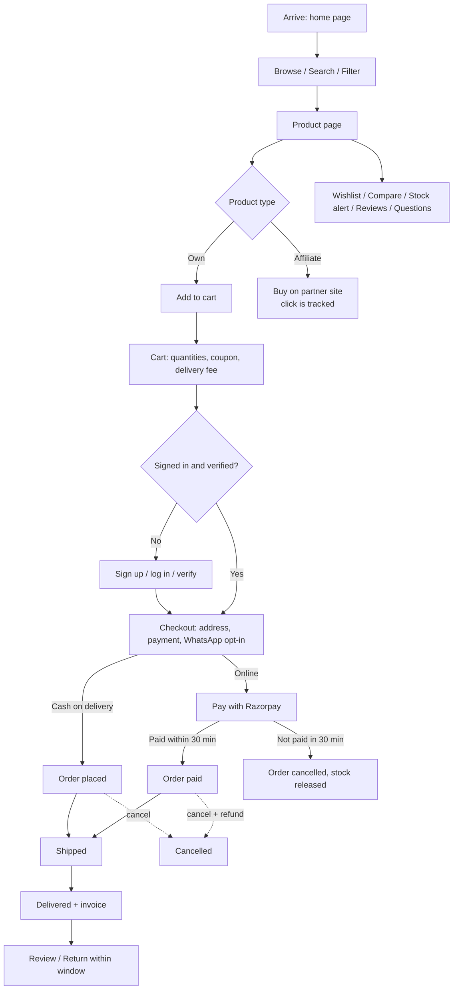
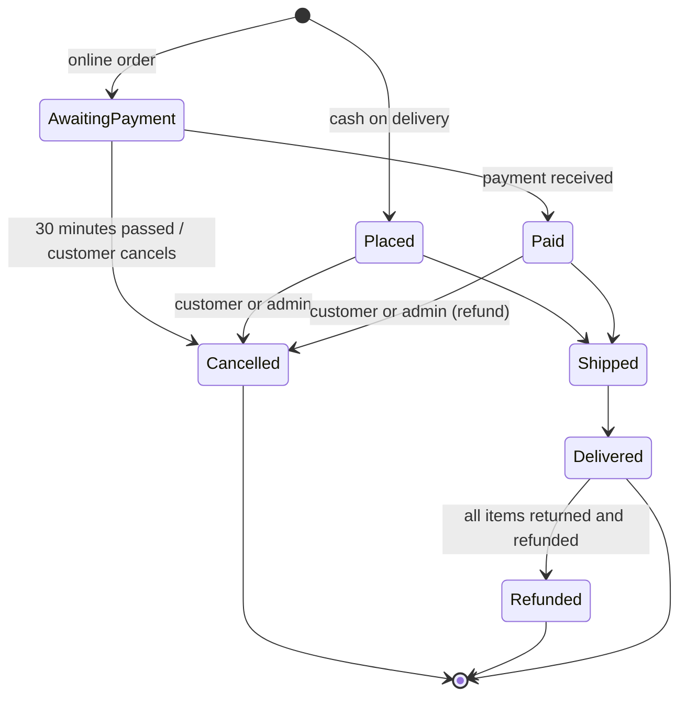

# 02 Customer journey: every step, end to end

This document follows a shopper through the whole service. Each section says what the shopper sees, what the system does, and what rules apply.

## 1. Arriving and finding things

| Step | What the shopper can do | Notes |
|---|---|---|
| Home page | See banners and offers, category shortcuts, product rows (featured, new, best sellers, top rated, a category, hand-picked), trust points, FAQ and more | The owner arranges it in Admin → Home page |
| Browse | Open **Products** and narrow down by category, type (sold by the store or partner deals), featured, and price range | Lists are paged |
| Order | The list shows the newest products first; search results are ordered by relevance | |
| Search | Type in the search box. Suggestions appear as they type: up to 6 products with picture, price and category | Fast typo-tolerant search when Meilisearch is on; otherwise the database search takes over automatically |
| Categories | Each category has its own page of products | Categories can be nested |

## 2. The product page

A shopper sees: name, brand, price (with the original price crossed out when discounted), picture gallery, videos, highlights, specifications, description, delivery information, return policy, stock status, average rating and reviews, and answered questions.

| Action | Own product | Affiliate product |
|---|---|---|
| Add to cart | Yes, when in stock | Not shown |
| Buy | Through the cart and checkout | **"Buy on <partner>"** button: records the click, then opens the partner's page. A disclosure explains the store may earn a commission |
| Add to wishlist | Yes (needs an account) | Yes |
| Compare with others | Yes, up to 4 products side by side (saved in the browser, no account needed) | Yes |
| "Notify me" when sold out | Yes (needs an account): one email when it is back | n/a |
| Read reviews | Yes | Yes |
| Write a review | Verified customers only | Verified customers only |
| Ask a question | Verified customers only | Verified customers only |

Each product page is also prepared for search engines (title, description, structured data, canonical address).

## 3. Wishlist

- Heart a product to save it. The wishlist page lists saved products; the shopper can remove them or add them to the cart.
- Needs an account, so the list follows the shopper to any device.

## 4. Cart

- The cart is kept **in the browser**, so it works without an account and survives closing the tab.
- The shopper changes quantities (up to 99 of a line), removes items, and sees the subtotal.
- **Coupon box:** enter a code to see the discount. Codes meant for this customer (private codes) are listed in My account and can be tapped to apply. Codes the customer can use are listed by default under "Offers for you" with a one-tap Use code button; a code whose minimum order is not reached yet shows as locked with how much more to spend, and it also appears on the progress bar at the amount that unlocks it. Codes already used by that customer (by account, email or mobile number) are no longer listed. The coupon lowers the price paid but never removes free delivery the cart had earned. A code that has already been used with the customer's email address or mobile number is refused with a clear message.
- **Delivery fee** is shown live: a flat fee, free above a set amount, always free, or never free (the owner decides in Settings). Default: ₹49, free above ₹499. Heavy products and some areas (by PIN code) can have their own delivery charge, big orders can ship free on everything, and a progress line at the top of the cart and checkout shows what is left to spend for free delivery and gifts.
- **Tax:** when the store charges GST the amounts shown include the right treatment; the invoice shows the details.
- Signed-in customers who leave a cart behind may receive one reminder email an hour or more later (they can switch these off in My account or with the link in the email).

## 5. Sign up and log in

| Method | How it works |
|---|---|
| Email and password | Name, email, password (8+ characters with letters and numbers, not a common password, not containing their name or email) and the tick for Terms and Privacy. A verification link is emailed |
| Mobile number | Enter the number, receive a 6-digit code by text (valid 10 minutes, 5 tries, 30 seconds between sends, 5 per hour), enter it. A number counts as verified |
| Google | One click "Continue with Google". Google confirms the email |
| Forgot password | Enter the email; a reset link valid for 1 hour is sent. Resetting signs the customer out of every device |
| Lockout | Five wrong passwords in a row lock password sign-in for 15 minutes (resetting the password lifts it) |

**Verified** means an email address or mobile number has been confirmed. Unverified visitors can browse, search, use the cart and wishlist. They must verify to **place an order, write a review or ask a question**; a banner and a "send me a verification email" button guide them.

## 6. Address and phone number

- **My account → Saved addresses:** add, edit, delete and choose a default. An address has name, phone, address lines, city, state and pincode.
- At checkout the shopper picks a saved address or types a new one (state chosen from a list; pincode and phone checked).
- Phone-number accounts can **add an email address** (confirmed by a link); email accounts can **add and verify a mobile number** with a code; any account can **link Google**. This keeps order updates and account recovery reaching the customer.
- Accounts made with a phone number or Google have no password at first; **Set a password** in My account (an email must be on the account) to also sign in with email.

## 7. Checkout and payment

1. **Review:** items, subtotal, coupon discount, delivery fee, tax treatment, total.
2. **Choose payment:**
   - **Cash on delivery:** the order is placed immediately.
   - **Online (when the store has Razorpay):** the customer pays by card, UPI or net banking in the secure Razorpay window. If they do not finish, the order stays "Awaiting payment" and holds the stock for **30 minutes**, then is cancelled automatically and the stock released. A "Pay now" button on My orders lets them complete it within that time.
3. **WhatsApp tick (optional, when the store has WhatsApp):** "Send my order updates on WhatsApp". Only customers who tick it are messaged.
4. **Place order.** Stock is reserved at once, so two customers can never buy the last unit.

## 8. Order tracker (My orders)

Each order card shows the order number, date, items, price breakdown and a status badge:

| Status shown | Meaning |
|---|---|
| Awaiting payment | Online order not yet paid (30-minute window) |
| Order placed | Cash on delivery order accepted |
| Paid | Online payment received |
| Shipped | On its way |
| Delivered | Reached the customer. The **invoice** link appears; returns open |
| Cancelled | Cancelled (the reason is shown) |
| Refunded | Fully returned and refunded |

The customer is told of every change by email (and text or WhatsApp where applicable, see [notifications](07-notifications.md)). The **invoice** (tax invoice when GST is on, bill of supply otherwise, with a running invoice number) opens in a new tab from any order that has been paid or placed.

## 9. Cancelling an order

- Available on orders that are **awaiting payment, placed or paid** (not once shipped).
- The shopper picks a reason (ordered by mistake, found a better price, delivery will take too long, want to change items or address, no longer need it, other) and may add a note.
- The system cancels the order, **returns the stock**, and for a **paid online order starts the refund** to the original payment method automatically (banks usually take 5 to 7 business days). If the refund cannot be started the cancellation is undone and the customer is told.
- Admins see the reason on the order.
- After shipping or delivery the shopper uses a **return** instead.

## 10. Returning items and getting a refund

- After delivery, **Return or refund** appears on the order for the number of days set by the store (default **7 days**; 0 turns returns off). The deadline is shown.
- The shopper ticks the items and quantities (part of an order is fine, and several requests are allowed until everything is returned), picks a reason, adds details, and for **cash on delivery orders gives a UPI ID** to receive the money.
- Status steps: **Return requested** → **approved** (or **declined** with the reason) → **refunded**.
- **Refund amount:** the price of the returned items minus their share of any coupon discount. Delivery is refunded only when the last items come back. Online orders are refunded to the original payment method automatically; cash orders are paid to the UPI ID by the admin and marked **paid** with a transaction reference, and the customer sees "Paid to <UPI> on <date>".
- Returned items go back into stock.

## 11. Reviews and questions

- **Reviews:** verified customers rate 1 to 5 with an optional title and a text. Reviews from people who bought the product show a **Verified purchase** badge. One review per product per customer (editing replaces it). Author names show first name only.
- **Questions:** verified customers can ask (up to 3 open at a time). The question appears publicly only after staff or an admin answers it, and the asker is emailed the answer.

## 12. My account

| Section | What it does |
|---|---|
| Profile | Name, email, phone, verified badges, resend verification |
| My coupons | Personal codes meant for this customer |
| Saved addresses | Manage delivery addresses |
| Email preferences | Switch cart-reminder emails on or off |
| Ways to sign in and get updates | Add an email address, add a mobile number, link Google |
| Password | Change it, or set a first one |
| Your data | **Download my data** (a file with profile, addresses, orders, returns, reviews, questions, wishlist; never passwords) and **Delete my account** |

**Deleting an account** needs the word DELETE plus proof it is them (password, a code texted to their phone, or Google). It removes the profile, addresses, wishlist, reviews, questions and saved cart, frees the email and number, and signs out every device. Orders and invoices are kept under the name "Deleted customer" for tax records. It is refused while an order is on its way, a return is open, or a refund is still owed.

## 13. Other pages shoppers can open

About, Contact (phone, email, address, care hours, WhatsApp, social links), Terms and Conditions, Privacy Policy, Refund Policy, Shipping Policy, Affiliate Disclosure, and the one-click Unsubscribe page for cart reminders. A floating WhatsApp button can appear on every page.
