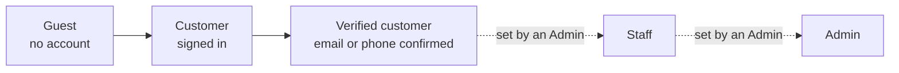

# 03 Roles and permissions

The service has four kinds of people. What each can do is enforced by the server, not just hidden in menus: even someone who guesses an address in the browser is refused.

| Role | Who | Console |
|---|---|---|
| **Guest** | Anyone browsing | Storefront only |
| **Customer** | Anyone with an account. **Verified** once an email address or mobile number is confirmed | Storefront and My account |
| **Staff** | A team member | Staff console: Orders, Returns, Questions, Products (read-only), Attention list |
| **Admin** | An owner or senior manager | Full admin console |

Roles are changed only by an admin, in **Admin → Users**. There must always be at least one admin; the last admin cannot be demoted. Admins can also sign a person out of every device.

## What each role can do

Legend: ✅ allowed · ❌ not allowed · ➖ not applicable

### Shopping

| Capability | Guest | Customer (not verified) | Customer (verified) |
|---|---|---|---|
| Browse, search, filter, view products | ✅ | ✅ | ✅ |
| Compare products (browser only) | ✅ | ✅ | ✅ |
| Use the cart | ✅ | ✅ | ✅ |
| See delivery fee and try a coupon at checkout | ✅ | ✅ | ✅ |
| Use the wishlist | ❌ | ✅ | ✅ |
| Ask to be told when a product is back in stock | ❌ | ✅ | ✅ |
| Click through to an affiliate partner | ✅ | ✅ | ✅ |
| Place an order | ❌ | ❌ (verify first) | ✅ |
| Pay for an awaiting-payment order | ❌ | ✅ (own orders) | ✅ |
| View own orders, invoices, tracker | ❌ | ✅ | ✅ |
| Cancel own order before it ships | ❌ | ✅ | ✅ |
| Request a return after delivery | ❌ | ❌ | ✅ |
| Write a review | ❌ | ❌ | ✅ |
| Ask a product question | ❌ | ❌ | ✅ |
| Manage own addresses, coupons list, email preferences | ❌ | ✅ | ✅ |
| Add email / phone / Google, set or change password | ❌ | ✅ | ✅ |
| Download or delete own data | ❌ | ✅ | ✅ |

### Running the store

| Capability | Staff | Admin |
|---|---|---|
| Open the admin area | ✅ (smaller console) | ✅ |
| See all orders and their details | ✅ | ✅ |
| Move an order to Paid, Shipped, Delivered | ✅ | ✅ |
| **Cancel or refund an order** (moves money, returns stock) | ❌ | ✅ |
| See what the business paid for goods (cost prices) | ❌ | ✅ |
| See returns; **approve** or **decline** them | ✅ | ✅ |
| **Refund** a return; record a cash-order **payout** | ❌ | ✅ |
| See and answer customer questions; delete a question | ✅ | ✅ |
| See customers waiting for back-in-stock alerts | ✅ | ✅ |
| See the "Attention" list (low stock, missing pictures...) | ✅ | ✅ |
| See the products list (without costs) | ✅ read-only | ✅ |
| Create, edit, delete products; bulk edit; import and export CSV | ❌ | ✅ |
| See the category list | ✅ | ✅ |
| Create, edit, delete categories | ❌ | ✅ |
| Moderate (delete) reviews | ❌ | ✅ |
| Banners and the home page layout | ❌ | ✅ |
| Coupons (create, edit, delete, see usage) | ❌ | ✅ |
| Brand and contact details | ❌ | ✅ |
| Store settings (delivery, tax, invoice, returns, stock alerts, reports) | ❌ | ✅ |
| Analytics, sales reports, affiliate click report | ❌ | ✅ |
| Abandoned carts | ❌ | ✅ |
| Users: list, export, change roles, sign people out | ❌ | ✅ |
| Audit log (who changed what) | ❌ | ✅ |
| Search index status and rebuild | ❌ | ✅ |

### Why staff cannot move money

Cancelling, refunding and cash payouts change real money and stock. They stay with admins so that a day-to-day team can fulfil orders without any risk to the books. The same rule protects cost prices, customer lists, settings and reports.

## Rules that apply to everyone

- Sessions are secure cookies; changing or resetting a password signs the person out everywhere.
- Five wrong passwords lock password sign-in for 15 minutes.
- Every change made in the admin area is recorded in the **audit log** with who made it. Attempts by staff to do something forbidden are recorded too.
- An admin cannot remove the last admin account, and a person cannot delete their own account while holding the staff or admin role (another admin changes the role first).
