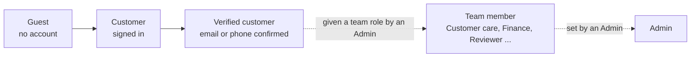

# 03 Roles and permissions

The service has guests, customers, **team members** and admins. What each can do is enforced by the server, not just hidden in menus: even someone who guesses an address in the browser is refused.

| Role | Who | Console |
|---|---|---|
| **Guest** | Anyone browsing | Storefront only |
| **Customer** | Anyone with an account. **Verified** once an email address or mobile number is confirmed | Storefront and My account |
| **Team member** | Someone who works for the business and has a **team role** | Only the parts of the admin console their role covers (see below) |
| **Admin** | An owner or senior manager | Everything, including the team and its roles |

Only an **admin** can give or change roles: team roles are made in **Admin → Team & roles**, and a person is given one in **Admin → Users** (or on the Team page). Nobody else can see those pages or raise their own access. There must always be at least one admin; the last admin cannot be demoted. Admins can also sign a person out of every device.

## Team roles

A team role is a named list of permissions, made by an admin to match a real job. A team member sees only the menu entries their role allows and the server refuses everything else. Changing a role applies to everyone holding it on their next click, with no need to sign in again. A role that people hold cannot be deleted until they are moved.

### Ready-made roles

Choosing **+ New role** offers these starting points; each can be renamed and adjusted before saving.

| Role | What it is for | Main permissions |
|---|---|---|
| Order fulfilment executive | Packs and ships | View and process orders, products, stock alerts |
| Customer care executive | Answers customers, handles orders and decides returns | Orders (view, process), returns (view, approve/decline), questions, products, customers |
| Customer care lead | Care with money authority | The above, plus cancel/refund orders, refund returns, moderate reviews, stock alerts |
| Finance and accounts | Books and money | View orders, cancel/refund orders, returns and refunds, products **with cost prices**, analytics, audit log |
| Catalogue manager | Owns the catalogue | Edit products and categories, cost prices, stock alerts |
| Product reviewer | Quality of what customers read | Moderate reviews, answer questions, view products |
| Marketing manager | Promotions and content | Coupons, banners, home page and pages, brand and look, analytics, view products |
| Inventory and warehouse | Keeps stock right | Edit products, stock alerts, manage stock and warehouses, view and process orders |
| Store manager | Runs the shop day to day | Everything except store settings and the team |

### The permissions

Each permission is a tick box. Ticking one that needs another ticks that too (for example *Process orders* needs *View orders*). Money, personal-data and settings permissions are marked **Sensitive**.

| Area | Permissions |
|---|---|
| Orders and delivery | View orders · Process orders (paid, shipped, delivered, tracking) · Cancel and refund orders |
| Returns | View returns · Approve or decline returns · Refund returns and record payouts |
| Products and stock | View products · Create and edit products (also CSV import/export and pictures) · Manage categories · See cost prices · See stock alerts (also the warehouses and stock history) · Manage stock and warehouses |
| Customers and community | Moderate reviews · Answer customer questions · View customers · Export customers |
| Marketing and content | Manage coupons · Manage home page and pages · Manage brand and look |
| Business | View analytics and reports (includes profit) · View the audit log · Manage store settings |

Without *See cost prices*, costs are removed from products, orders and the CSV export, and saving a product keeps the costs already stored. Someone who may view customers sees customer accounts only, never colleagues or admins.

### Staff made before roles existed

A staff member with no team role keeps the original staff access: orders (view, process), returns (view, approve/decline), questions, products (read-only, no costs) and stock alerts. Give them a role to be exact.

## What each role can do

Legend: ✅ allowed · ❌ not allowed · ➖ not applicable

### Shopping

| Capability | Guest | Customer (not verified) | Customer (verified) |
|---|---|---|---|
| Browse, search, filter, view products | ✅ | ✅ | ✅ |
| Compare products (browser only) | ✅ | ✅ | ✅ |
| Use the cart | ✅ | ✅ | ✅ |
| See delivery fee and try a coupon at checkout | ✅ | ✅ | ✅ |
| Use the wishlist | ❌ | ✅ | ✅ |
| Ask to be told when a product is back in stock | ❌ | ✅ | ✅ |
| Click through to an affiliate partner | ✅ | ✅ | ✅ |
| Place an order | ❌ | ❌ (verify first) | ✅ |
| Pay for an awaiting-payment order | ❌ | ✅ (own orders) | ✅ |
| View own orders, invoices, tracker | ❌ | ✅ | ✅ |
| Cancel own order before it ships | ❌ | ✅ | ✅ |
| Request a return after delivery | ❌ | ❌ | ✅ |
| Write a review | ❌ | ❌ | ✅ |
| Ask a product question | ❌ | ❌ | ✅ |
| Manage own addresses, coupons list, email preferences | ❌ | ✅ | ✅ |
| Add email / phone / Google, set or change password | ❌ | ✅ | ✅ |
| Download or delete own data | ❌ | ✅ | ✅ |

### Running the store

The columns show the permission that opens each capability; an admin has all of them. A team member needs the permission in their role.

| Capability | Permission needed | Admin |
|---|---|---|
| Open the admin area | any team role | ✅ |
| See all orders and their details | View orders | ✅ |
| Move an order to Paid, Shipped, Delivered; add courier tracking; mark many orders shipped at once | Process orders | ✅ |
| Print shipping labels and packing slips | View orders | ✅ |
| **Cancel or refund an order** (moves money, returns stock) | Cancel and refund orders | ✅ |
| See what the business paid for goods (cost prices) | See cost prices | ✅ |
| See returns | View returns | ✅ |
| **Approve** or **decline** a return | Approve or decline returns | ✅ |
| **Refund** a return; record a cash-order **payout** | Refund returns and record payouts | ✅ |
| See and answer customer questions; delete a question | Answer customer questions | ✅ |
| See customers waiting for back-in-stock alerts; the Attention list | See stock alerts | ✅ |
| See the warehouses, units in each, and the stock history | See stock alerts | ✅ |
| Add or switch off warehouses; receive stock; correct a count; move stock between warehouses | Manage stock and warehouses | ✅ |
| See the products list (without costs) | View products | ✅ |
| Create, edit, delete products; bulk edit; import and export CSV; upload pictures | Create and edit products | ✅ |
| Create, edit, delete categories | Manage categories | ✅ |
| Moderate (delete) reviews | Moderate reviews | ✅ |
| Banners, the home page layout, pages & policies | Manage home page and pages | ✅ |
| Coupons (create, edit, delete, see usage) | Manage coupons | ✅ |
| Brand and contact details; store look and offered currencies | Manage brand and look | ✅ |
| Store settings (delivery, tax, invoice, returns, stock alerts, reports); search index | Manage store settings | ✅ |
| Analytics, sales reports, affiliate click report, abandoned carts | View analytics and reports | ✅ |
| Audit log (who changed what) | View the audit log | ✅ |
| Customer accounts and their order history | View customers | ✅ |
| Export the customer list | Export customers | ✅ |
| Change someone's role, sign people out, manage the team and its roles | Admin only | ✅ |

### Why money and personal data have their own permissions

Cancelling, refunding and cash payouts change real money and stock; cost prices, customer lists, settings and reports are sensitive. Each has its own permission so a day-to-day team can fulfil orders without any risk to the books, and an owner decides exactly who gets more.

## Rules that apply to everyone

- Sessions are secure cookies; changing or resetting a password signs the person out everywhere.
- Five wrong passwords lock password sign-in for 15 minutes.
- Every change made in the admin area is recorded in the **audit log** with who made it. Attempts to do something a role does not allow, and creating, changing or deleting a team role, are recorded too.
- An admin cannot remove the last admin account, and a person cannot delete their own account while holding a team role or the admin role (an admin changes the role first).
