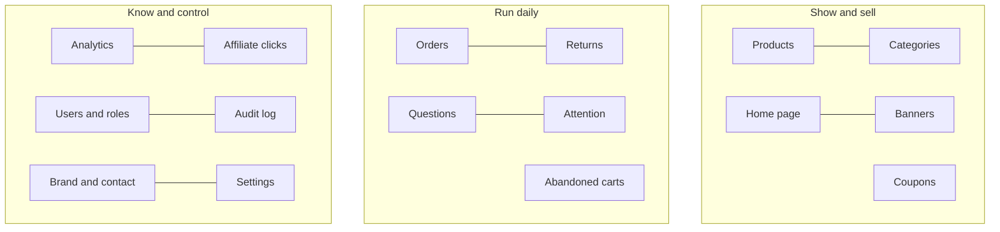

# 04 Admin guide: running and configuring the store

The admin console is at `/admin` on your website. Log in with an account whose role is **Admin**. The left menu lists every screen below. (Staff see a smaller menu, see [05 Staff guide](05-staff-guide.md).)

## First-time setup order

1. **Brand & contact**: make the shop yours.
2. **Settings**: delivery, tax, returns, alerts.
3. **Categories**, then **Products**.
4. **Home page** and **Banners**.
5. **Coupons** for your first offers.
6. **Users**: give your team the Staff role.

## Overview

The landing screen: how many products (published, drafts, own, affiliate), revenue, profit and units sold over the last 30 days, affiliate clicks, the top affiliate products, items needing attention, recently updated products, and the search index status with a **Rebuild** button. Links lead to the detailed screens.

## Brand & contact

Everything customers read about you. Changes show everywhere: header, footer, page titles, emails, invoices and the payment window.

| Section | What you set |
|---|---|
| Logo and brand | Store name, website address (used in emails, links and the sitemap), tagline, and the logo designer (below) |
| Legal and grievance details | Registered business name, GSTIN, grievance officer and grievance email. They appear on the Contact & Grievance page and in the policies |
| About us | The text of the About page |
| Contact | Email, phone, address |
| Customer care | Care hours and a short care note |
| Connect with us | WhatsApp number, opening message and the floating WhatsApp button on or off; social links (Facebook, Instagram, X, YouTube, LinkedIn, Pinterest...); extra links of your own |

## Pages & policies

Where you write the pages in your footer: Terms & Conditions, Privacy Policy, Shipping Policy, Cancellation & Refund Policy and Affiliate Disclosure, plus any page of your own (size guide, FAQ, warranty...). Admin only.

| What you can do | How |
|---|---|
| Keep the ready-made wording | Leave a policy on "Use the standard text". It already uses your brand name, address and legal details |
| Write your own wording | Edit the page, choose "Write my own text", then type or paste. "Start again from the standard text" gives you the ready-made text to change. The preview shows exactly how it will look |
| Add a page | "+ Add a page", give it a title and text. It opens at /pages/your-address and appears in the footer |
| Hide a page | Untick "Show this page on the website". It leaves the footer and the sitemap and can no longer be opened |
| Go back | "Reset to standard" on a policy, or "Delete page" on one you added |

Formatting is simple: `## Heading` for a section, `- item` for bullets, `1. item` for a numbered list, `**bold**`, `*italic*` and `[link text](https://...)`. Words in braces such as `{brand}`, `{company}`, `{address}`, `{email}`, `{phone}`, `{gstin}` and `{grievanceOfficer}` are replaced with your details, so the same text keeps working if you change them. Pasted code is shown as plain text, never run.

The same screen has the **message bar** above the header (for example "Free delivery on orders above ₹499 this week") and the **Transparency box** in the footer: change the wording or switch either off.

The standard policies are a starting point, not legal advice. Have a legal professional review them before you launch.

## Appearance & currency

Admin only. Two things shoppers see, both set here.

| Control | What it does |
|---|---|
| Store look | Choose Default, Minimalism, Maximalism, Glassmorphism, Neumorphism, Flat design, Material design or Editorial design. The whole shopper-facing site changes at once; the admin console keeps its normal look. Default is the store exactly as it was. Click a card, then Save look |
| Header, search bar and footer | A live preview and, for each part (header, search bar, category bar, footer), a colour picker or a typed colour such as `#1e3a8a`. The header and footer can also have a **picture** (drag in, paste or upload, or give an https address) with a **tint** slider: a layer of the background colour over the picture so the text stays readable. Leave a text colour empty (Auto) and a readable light or dark colour is chosen for you. Hard-to-read pairs are flagged before you save. "Back to standard colours" restores the original look. It works on top of the store look |
| Currencies offered | Tick the currencies shoppers can view prices in. A switcher appears in the header and prices convert immediately; the choice is remembered on the shopper's device |
| Currency for new visitors | The currency first-time visitors see |
| Live rate and your own rate | Rates refresh automatically every few hours (use "Fetch today's rates" to refresh now). Type your own rate for a currency to fix it; leave it empty to follow the live rate |

Converted prices are a guide. Customers are always charged in Indian rupees, and orders, invoices, refunds and the admin console stay in rupees.

### Designing your logo

In Brand & contact, under "Logo and brand", choose how the logo looks. A live preview shows it on the dark header and on a light page.

| Style | What you set |
|---|---|
| Picture logo | Upload your logo file. Pick an effect (flat, soft shadow, 3D depth, glow). Use "Make background transparent" to remove a plain white or coloured box around the logo, so the website shows through. Tick "white badge" only for dark logos that disappear on the dark header |
| Text logo | Type the text (empty uses your brand name). Choose a font from 14 styles, weight, size, letter spacing, italic and capitals. Colour: match the page, one colour, a different colour for each letter (or a quick palette), or a gradient. Effect: flat, soft shadow, 3D with a depth setting, outline or glow. There is no background, so your website shows through |

Check the colours on both previews: a dark logo needs the light preview, a light one the dark preview. "Match the page" always stays readable.

## Settings

| Section | Fields | Effect |
|---|---|---|
| Delivery charges | Delivery fee (₹); free delivery for orders of ₹ or more; free delivery on everything for orders of ₹ or more | Fee added at checkout. Leave the free-over amount empty to never give free delivery; set the fee to 0 for always free. Default ₹49, free from ₹499. The first amount is measured on the whole basket but only waives the charge on regular products; the "everything" amount waives every delivery charge, heavy items and areas with their own fee included (see Delivery rules below) |
| Delivery by area | Name, PIN code starts (for example 79, 744, 795001), fee, optional free-over amount | Customers whose PIN code starts with one of those digits pay the area's fee instead of the store fee (the longest matching start wins). Tick "free for bigger orders" to let big orders ship free there; leave it off for never free by amount |
| Rewards for big orders | Order amount, then either a **free gift or surprise** (its name) or a **percentage off the order** (with an optional maximum in rupees); up to 8 | Customers see them on a progress line in the cart and checkout, and a small confetti celebration plays when a reward is unlocked. A gift is listed on the order in Orders ("Pack with this order") and in the customer's My orders. A percentage off is taken from the order automatically, before any coupon; only the best one reached applies, they do not add up. Amounts are measured on the cart value before any coupon |
| Returns | Return window (days) | How long after delivery customers can ask to return. 0 turns returns off. Default 7 |
| Inventory alerts | Low stock level (units); email the alerts to | When an own product falls to or below the level, one email lists it. Blank address = no alerts. Default level 5 |
| Sales report by email | How often (off, weekly on Monday, monthly on the 1st); send it to | A CSV of the last period's sales, with tax columns, is emailed automatically. A "send now" button is provided |
| GST and invoices | GSTIN, business name on invoices, business address, state, GST on delivery charges, invoice number prefix | With GST on, invoices are tax invoices with your details; otherwise bills of supply. Invoice numbers run in sequence from the prefix (for example DZ/2026-27/00001, with the financial year in the middle) |

## Products

**List:** search by name or SKU; filter by type (own or affiliate), status (draft or published), stock (low or out) and price range; sort by last updated, date added, name, price or stock; select several and **bulk edit** status, featured flag, price or stock; **Export** all products to a spreadsheet; **Import** from a spreadsheet (with a dry run that reports problems before anything changes).

**Add or edit a product:**

| Group | Fields |
|---|---|
| Basics | Name, address slug, brand, category, short description, status (draft hides it from the shop; published shows it), featured flag |
| Pictures and video | Upload pictures (first one is the main picture; reorder them), add video links, or upload a short promo video (MP4 or WebM, up to 60 seconds and 50 MB) |
| Price | Selling price, original price (MRP, shown crossed out), optional deal label |
| Details | Highlights (bullet points), specifications (name and value pairs), delivery information, return policy text |
| Own product | Stock, SKU, what it cost you (admin-only), low-stock level follows the global setting |
| Delivery charge (own products) | "Delivery charge": follow the store's rules (default), always free, or always charge (heavy or bulky) with an optional fee | Always charge adds that fee (or the store fee when left empty) once per order for the product, even in a big order. Always free never adds to the charge and the product page says FREE delivery |
| Returns (own products) | "Can customers return it?": the store's return period (default), a number of days you choose, or **No returns**. A product marked no returns (or whose return text says "No return") shows a crossed-out return icon and "No returns" before purchase, and once it ships no return or refund request can be made for it. Each order keeps the rule it was placed under, even if you change the product later |
| Product card | Pack size, chosen by what the product is: a quantity in pieces for gadgets and electricals ("1 piece"), ml or litres for shampoo and drinks ("100 ml", "2 L"), grams or kilograms for groceries ("500 g", "1.5 kg"), or free text for several sizes ("600 ml, 800 ml"), sale tag ("Top Discount of the Sale" or "Lowest price in the year", set by you, so only use one that is true), show or hide the "bought" count, and an optional multi-buy offer ("Buy 2 items, save extra 3%") |
| Affiliate product | Partner (platform) name, partner link, disclosure text |
| Timed sale (own products) | A sale price and an end time. The product page shows a countdown ("Sale ends in 02 Hrs : 21 Min : 46 Sec"), the cart and checkout charge the sale price, and the normal selling price returns by itself when the time is up |
| Colour and size options | A group name shared by the products of one item, plus a colour. The product page then shows colour pictures and size buttons (from the pack size) that open the other products; sold-out sizes are crossed out |
| Warranty and manufacturer | Warranty wording, and the manufacturer, packer and country of origin as printed on the pack |

**What the shop shows on each product card, by itself:** a green, amber or red rating badge (4.2 ★) with the number of reviews, how many were bought (counted from real orders, not cancelled or refunded), the discount as "83% off", and "Only few left" when stock is at or below the low-stock level in Settings. A multi-buy offer is a real saving: the cart and checkout apply it automatically when the customer buys enough, and the order and invoice carry the discounted price. Importing a spreadsheet leaves these fields as they are.

**Delivery rules:** (1) regular products ship free once the regular items in the basket reach the store's free-delivery amount; (2) heavy or bulky products always pay their own delivery, even in a big order; areas with their own fee charge that fee instead of the store fee; (3) with a heavy item and regular items in one basket, the heavy item's money counts towards the free-delivery amount, so the regular items ship free and only the heavy item's delivery is charged; (4) once the whole basket passes the "free delivery on everything" amount, all delivery is free. Amounts are measured on the cart value before any coupon, so a coupon lowers what is paid but never takes away free delivery or a gift the cart had earned. The product page, cart and checkout show the matching delivery label, and the cart and checkout show a progress line for what is left to spend for free delivery and gifts.

**PIN codes:** the product page has a delivery check where a visitor types a PIN code and sees where it is and when the product would arrive. The checkout and saved addresses check PIN codes as they are typed (a PIN code that does not exist is refused, and the city is filled in when it is empty; a state that does not fit only shows a warning). Lookups use the India Post PIN code service; if it cannot be reached, the first digits of the PIN code are checked instead, so an outage never stops an order.

**Reviews:** signed-in customers can add up to 5 photos and one short video (30 seconds) with their review. Photos are re-saved without their hidden details such as location. Reviews show the name the customer gave, or half of their phone number or email (for example 98765*****) when they never gave a name.

**On every product page:** a share button (opens the phone's share sheet, or a menu with a link to copy and WhatsApp, Facebook, X, Telegram and email), a "Visit brand store" link, "Buy now", a buy bar that sticks to the bottom of a phone screen, and a row of buying promises (pay on delivery, the return window from Settings, cancel before it ships, secure checkout). Reviews slide sideways; once a product has more than 8, a "View all reviews" page lists every review with sorting. A visitor who is not signed in and presses "Proceed to checkout" or "Buy now" is asked to sign up or log in first, and lands back at checkout afterwards.

Pictures up to 5 MB each (JPG, PNG, WebP, GIF). The shop automatically creates smaller versions so phones load fast.

## Categories

Create, rename and delete categories, with parents and sub-categories. A category that still has products or sub-categories cannot be deleted.

## Home page

Build the front page like blocks:

| Block | Use |
|---|---|
| Banners | The big slider of your banners |
| Trust bar | Short reassurance points (delivery, returns, secure payment) |
| Categories / Category slider | Shortcuts to shelves |
| Products / Product slider | Rows of products from a source: featured, sold by you, partner deals, new, best selling, top rated, one category, or a hand-picked list |
| Promo banner | One highlighted offer with an image, text and a button |
| Image tiles / Tile carousel | Picture links to categories or campaigns |
| Icon grid | A wall of small picture buttons with a label under each (3 to 10 per row), such as shop by category icons. Choose a size (extra small to large) and a shape (rounded square, circle, square, wide or tall rectangle); the size menu shows the picture size to upload, and pictures are cropped to fit automatically when uploaded (can be turned off). Optional coloured bar |
| Brand promo cards | Colourful cards with a brand logo tab, a headline such as "Up to 35% Off" and a product picture; two or three per row |
| Wide image banner | One wide picture that links anywhere, with an optional "AD" tag and a different picture for phones. Good for a brand in the spotlight |
| Offer cards | Picture cards in a slider or a grid. Each card can have a price or discount strip ("Under ₹279"), a caption, an "AD" tag and a link. Add a coloured panel behind the cards (gold, purple, green, dark) or your own picture with an optional tint and text colour, plus a header picture for festive sections, deal strips, partner logos or story cards |
| Text | A heading and paragraph |
| FAQ | Questions and answers |
| How it works | Simple steps |
| Spacer | Breathing space |
| Ad slot | An advertising unit (when you use ads) |

Reorder blocks, switch them on or off, edit each one's settings, and **Reset** to the default layout at any time.

## Banners

Create promotions with title, subtitle, image (or a short video), button label and link, text colour (light or dark), text and button position, an optional sponsor name, **start and end date and time**, an optional countdown, and an on/off switch. Drag to reorder. The system counts how many times each banner was shown and clicked.

## Coupons

| Field | Meaning |
|---|---|
| Code | What the customer types (case does not matter) |
| Note for yourself | Internal description |
| Discount type | Percentage, or a flat rupee amount |
| Minimum order | The basket must reach this |
| Maximum discount | A ceiling for percentage coupons |
| Valid from / until | Date window |
| Total uses allowed | Across all customers |
| Uses per customer | Per person. A person is recognised by account, email address and mobile number, so a second account with the same email (Gmail ignores dots and +tags) or the same mobile number, or an order delivered to that mobile number, cannot use the code again |
| Only for these customers | A **private code** for one or many customers, given as emails or mobile numbers, one per line. Only they can use it and it shows in each one's My account. Each can use it once unless you set uses per customer |
| First order only | Only for customers who have not ordered before |
| Show this code to customers who can use it | On by default. The code is listed under "Offers for you" in the cart and checkout of every customer who can use it and has not used it, and it appears on the cart's progress bar at the minimum order that unlocks it, so customers see how much more to spend. Private codes are listed only to their customers. Switch off for codes you hand out yourself; they still work when typed |
| Active | Switch off without losing history |

The list shows how many times each code was used and the discount given. **Usage** lists every order that used the code, who placed it, the delivery mobile number, and whether it still counts against the limits. Cancelled and refunded orders give the use back (shown as "Released"). A code that has been used cannot be deleted, because the same code could then be made again and used a second time: switch it off instead.

## Orders

Filter by status. Open an order to see items, quantities, prices (and your cost, admin only), delivery address, phone, payment method, coupon, whether the customer agreed to WhatsApp updates, the cancellation reason, and any refund. Move it forward with the status control:

- **Placed / Paid → Shipped → Delivered** (staff and admins).
- **Cancelled** or **Refunded** (admins only): asks for confirmation, returns the stock, and for a paid online order refunds the customer automatically through Razorpay.

Every change emails the customer (and texts or WhatsApps where set up). The invoice link opens the printable invoice.

## Returns

| Filter | Shows |
|---|---|
| Needs review | New requests |
| Approved, Declined, Refunded | Their stage |
| **Payouts due** | Refunded **cash-on-delivery** returns not yet paid to the customer |

For each request you see the customer, items, reason, the amount a refund would be, and (for cash orders) the UPI ID. Actions:

1. **Approve return** (staff or admin), or **Decline** with a reason the customer will read.
2. When the items arrive, **Item received, refund** (admin). Stock goes back; online orders refund automatically; cash orders move to Payouts due.
3. For a cash order, send the money to the UPI ID from your bank app, then enter the **UPI transaction reference** and press **Mark as paid** (admin, once). The customer is told it was paid.

## Questions

Customers' questions per product. Type an answer to publish the question and email the asker, or delete it. Open questions show first.

## Attention

A to-do list of products needing care: low or no stock, missing pictures or descriptions, no reviews.

## Abandoned carts

Signed-in customers who left items behind: what they left and their value, when a reminder was sent. Reminders go out automatically about an hour after the customer leaves, once, unless they opted out.

## Analytics

Revenue, units and profit by day, week, month or year; order mix and payment mix (cash vs online); best categories and products; delivery backlog; a downloadable sales report CSV with tax splits for your accountant. **Affiliate clicks** shows which partner products earn clicks over the last 30 to 365 days.

## Users

Search by email, name or phone; filter by role and verification; see how each person signs in, their order count and spend; export to a spreadsheet. Open a person to change their **role** (Customer, Staff, Admin) or **sign them out of every device**. Deleted customers no longer appear here (their orders remain, labelled "Deleted customer").

## Audit log

A history of every change made in the admin area: who, when, what and which record. Names are copied at the time so the record stays readable if an account is later removed. Blocked attempts by staff are listed too.

## Search index

(On the Overview.) Shows whether fast search is healthy and lets you rebuild it after bulk changes. If it is down the shop silently uses the database search.

## Things only you can see

Cost prices, profit, customer lists, settings, reports, the audit log and money actions (cancel, refund, payout). Keep the Admin role for owners; give the team Staff.
