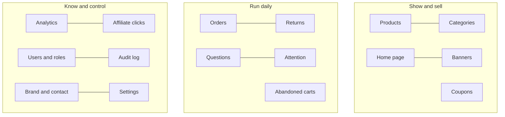

# 04 Admin guide: running and configuring the store

The admin console is at `/admin` on your website. Log in with an account whose role is **Admin**. The left menu lists every screen below. (Staff see a smaller menu, see [05 Staff guide](05-staff-guide.md).)

## First-time setup order

1. **Brand & contact**: make the shop yours.
2. **Settings**: delivery, tax, returns, alerts.
3. **Categories**, then **Products**.
4. **Home page** and **Banners**.
5. **Coupons** for your first offers.
6. **Users**: give your team the Staff role.

## Overview

The landing screen: how many products (published, drafts, own, affiliate), revenue, profit and units sold over the last 30 days, affiliate clicks, the top affiliate products, items needing attention, recently updated products, and the search index status with a **Rebuild** button. Links lead to the detailed screens.

## Brand & contact

Everything customers read about you. Changes show everywhere: header, footer, page titles, emails, invoices and the payment window.

| Section | What you set |
|---|---|
| Logo and brand | Store name, website address (used in emails, links and the sitemap), logo (and whether it sits on a white badge), tagline |
| About us | The text of the About page |
| Contact | Email, phone, address |
| Customer care | Care hours and a short care note |
| Connect with us | WhatsApp number, opening message and the floating WhatsApp button on or off; social links (Facebook, Instagram, X, YouTube, LinkedIn, Pinterest...); extra links of your own |

## Settings

| Section | Fields | Effect |
|---|---|---|
| Delivery charges | Delivery fee (₹); free delivery for orders of ₹ or more | Fee added at checkout. Leave the free-over amount empty to never give free delivery; set the fee to 0 for always free. Default ₹49, free from ₹499 |
| Returns | Return window (days) | How long after delivery customers can ask to return. 0 turns returns off. Default 7 |
| Inventory alerts | Low stock level (units); email the alerts to | When an own product falls to or below the level, one email lists it. Blank address = no alerts. Default level 5 |
| Sales report by email | How often (off, weekly on Monday, monthly on the 1st); send it to | A CSV of the last period's sales, with tax columns, is emailed automatically. A "send now" button is provided |
| GST and invoices | GSTIN, business name on invoices, business address, state, GST on delivery charges, invoice number prefix | With GST on, invoices are tax invoices with your details; otherwise bills of supply. Invoice numbers run in sequence from the prefix (for example DZ/2026-27/00001, with the financial year in the middle) |

## Products

**List:** search by name or SKU; filter by type (own or affiliate), status (draft or published), stock (low or out) and price range; sort by last updated, date added, name, price or stock; select several and **bulk edit** status, featured flag, price or stock; **Export** all products to a spreadsheet; **Import** from a spreadsheet (with a dry run that reports problems before anything changes).

**Add or edit a product:**

| Group | Fields |
|---|---|
| Basics | Name, address slug, brand, category, short description, status (draft hides it from the shop; published shows it), featured flag |
| Pictures and video | Upload pictures (first one is the main picture; reorder them), add video links, or upload a short promo video (MP4 or WebM, up to 60 seconds and 50 MB) |
| Price | Selling price, original price (MRP, shown crossed out), optional deal label |
| Details | Highlights (bullet points), specifications (name and value pairs), delivery information, return policy text |
| Own product | Stock, SKU, what it cost you (admin-only), low-stock level follows the global setting |
| Affiliate product | Partner (platform) name, partner link, disclosure text |

Pictures up to 5 MB each (JPG, PNG, WebP, GIF). The shop automatically creates smaller versions so phones load fast.

## Categories

Create, rename and delete categories, with parents and sub-categories. A category that still has products or sub-categories cannot be deleted.

## Home page

Build the front page like blocks:

| Block | Use |
|---|---|
| Banners | The big slider of your banners |
| Trust bar | Short reassurance points (delivery, returns, secure payment) |
| Categories / Category slider | Shortcuts to shelves |
| Products / Product slider | Rows of products from a source: featured, sold by you, partner deals, new, best selling, top rated, one category, or a hand-picked list |
| Promo banner | One highlighted offer with an image, text and a button |
| Image tiles / Tile carousel | Picture links to categories or campaigns |
| Text | A heading and paragraph |
| FAQ | Questions and answers |
| How it works | Simple steps |
| Spacer | Breathing space |
| Ad slot | An advertising unit (when you use ads) |

Reorder blocks, switch them on or off, edit each one's settings, and **Reset** to the default layout at any time.

## Banners

Create promotions with title, subtitle, image (or a short video), button label and link, text colour (light or dark), text and button position, an optional sponsor name, **start and end date and time**, an optional countdown, and an on/off switch. Drag to reorder. The system counts how many times each banner was shown and clicked.

## Coupons

| Field | Meaning |
|---|---|
| Code | What the customer types (case does not matter) |
| Note for yourself | Internal description |
| Discount type | Percentage, or a flat rupee amount |
| Minimum order | The basket must reach this |
| Maximum discount | A ceiling for percentage coupons |
| Valid from / until | Date window |
| Total uses allowed | Across all customers |
| Uses per customer | Per person |
| Only for one customer | A **personal code**: only that customer can use it and sees it in My account |
| First order only | Only for customers who have not ordered before |
| Active | Switch off without losing history |

The list shows how many times each code was used and the discount given. Cancelled and refunded orders give the use back.

## Orders

Filter by status. Open an order to see items, quantities, prices (and your cost, admin only), delivery address, phone, payment method, coupon, whether the customer agreed to WhatsApp updates, the cancellation reason, and any refund. Move it forward with the status control:

- **Placed / Paid → Shipped → Delivered** (staff and admins).
- **Cancelled** or **Refunded** (admins only): asks for confirmation, returns the stock, and for a paid online order refunds the customer automatically through Razorpay.

Every change emails the customer (and texts or WhatsApps where set up). The invoice link opens the printable invoice.

## Returns

| Filter | Shows |
|---|---|
| Needs review | New requests |
| Approved, Declined, Refunded | Their stage |
| **Payouts due** | Refunded **cash-on-delivery** returns not yet paid to the customer |

For each request you see the customer, items, reason, the amount a refund would be, and (for cash orders) the UPI ID. Actions:

1. **Approve return** (staff or admin), or **Decline** with a reason the customer will read.
2. When the items arrive, **Item received, refund** (admin). Stock goes back; online orders refund automatically; cash orders move to Payouts due.
3. For a cash order, send the money to the UPI ID from your bank app, then enter the **UPI transaction reference** and press **Mark as paid** (admin, once). The customer is told it was paid.

## Questions

Customers' questions per product. Type an answer to publish the question and email the asker, or delete it. Open questions show first.

## Attention

A to-do list of products needing care: low or no stock, missing pictures or descriptions, no reviews.

## Abandoned carts

Signed-in customers who left items behind: what they left and their value, when a reminder was sent. Reminders go out automatically about an hour after the customer leaves, once, unless they opted out.

## Analytics

Revenue, units and profit by day, week, month or year; order mix and payment mix (cash vs online); best categories and products; delivery backlog; a downloadable sales report CSV with tax splits for your accountant. **Affiliate clicks** shows which partner products earn clicks over the last 30 to 365 days.

## Users

Search by email, name or phone; filter by role and verification; see how each person signs in, their order count and spend; export to a spreadsheet. Open a person to change their **role** (Customer, Staff, Admin) or **sign them out of every device**. Deleted customers no longer appear here (their orders remain, labelled "Deleted customer").

## Audit log

A history of every change made in the admin area: who, when, what and which record. Names are copied at the time so the record stays readable if an account is later removed. Blocked attempts by staff are listed too.

## Search index

(On the Overview.) Shows whether fast search is healthy and lets you rebuild it after bulk changes. If it is down the shop silently uses the database search.

## Things only you can see

Cost prices, profit, customer lists, settings, reports, the audit log and money actions (cancel, refund, payout). Keep the Admin role for owners; give the team Staff.
