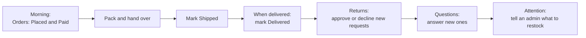

# 05 Staff guide: the daily routine

You have a **team role** in the admin console. Your admin chose what it covers, so your menu shows only your sections and the system refuses anything else (and records the attempt). This guide describes the day-to-day work of the common roles; your own menu is the truth for you.

## What you see in the menu

On sign-in you land on a start page with a button for each section your role covers.

| Screen | Needs this permission | You can |
|---|---|---|
| **Orders** | View orders (+ Process orders to move them) | See every order, open details, move orders to Paid, Shipped, Delivered, add tracking |
| **Returns** | View returns (+ Approve or decline) | See return requests, **approve** or **decline** them |
| **Questions** | Answer customer questions | Answer or delete customers' product questions |
| **Reviews** | Moderate reviews | Read every review and delete the ones that break the rules |
| **Products** | View products | Look up products and stock (no costs unless your role shows them); with *Create and edit products* you can change them |
| **Users** | View customers | Look up customers and their orders (customers only) |
| **Analytics, Audit log, Coupons, Settings...** | The matching permission | Only if your role includes them |

Cancelling or refunding orders, refunding returns and marking cash payouts as paid each need their own permission. Without it the buttons are not shown. If you need one, ask an admin to adjust your role. The rest of this guide describes the routine of the original staff role.

## A typical day

### 1. Orders

1. Open **Orders** and filter to **Placed** (cash on delivery) and **Paid** (online).
2. Open an order. Check items, quantities and the delivery address and phone.
3. Pack the parcel. Set the status to **Shipped**, type the courier and tracking number (and the tracking link if the courier gives one) and press **Mark as shipped**. The customer is told automatically, with those details.
4. When it is delivered, set **Delivered**. The invoice becomes available and the return window starts.
5. If the customer wants to cancel, they can do it themselves until you ship. After you ship, a cancellation or refund needs an admin.

Good to know:

- **Awaiting payment** orders are online orders not yet paid. They cancel themselves after 30 minutes. Do not ship them.
- The order shows whether the customer agreed to **WhatsApp** updates.
- If an order shows a **cancellation reason**, the customer cancelled it.

### 2. Returns

1. Open **Returns** (it opens on "Needs review").
2. Read the reason, the items and details.
3. **Approve return** if it is within policy, or **Decline** and write the reason (the customer reads it, so be polite and clear).
4. When approved items come back to the warehouse, tell an admin. Only an admin can press **Item received, refund** and record a cash payout.

### 3. Questions

Open **Questions**, read the product and the question, type a helpful answer and save. The answer appears on the product page and the customer is emailed. Delete spam or inappropriate questions.

### 4. Products and attention

Use **Products** to answer "do we have this in stock?" (stock and price are shown, not costs). **Attention** lists low-stock products and products missing pictures or descriptions: pass the list to an admin.

## Keeping customers happy: quick answers

| Customer asks | Answer |
|---|---|
| "Where is my order?" | Open the order. Status Shipped means it is on its way; Placed or Paid means packing |
| "Can I cancel?" | If not shipped, they can cancel in My orders. If shipped, offer a return once delivered |
| "How long do I have to return?" | The number of days set by the store (default 7) counted from delivery; the exact deadline shows on their order |
| "When will I get my money back?" | Online orders: refunded to the original payment method, banks take 5 to 7 business days. Cash orders: paid to their UPI ID by an admin; they are told when it is sent |
| "I forgot my password" | Use "Forgot password" on the login page. Five wrong tries lock sign-in for 15 minutes |
| "I signed up with my phone but get no emails" | They can add an email address in My account → Ways to sign in and get updates; meanwhile updates come by text message |
