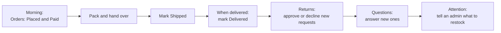

# 05 Staff guide: the daily routine

You have the **staff console**. It is built for fulfilling orders and helping customers. It deliberately hides money movements, costs, settings and reports.

## What you see in the menu

| Screen | You can |
|---|---|
| **Orders** | See every order, open details, move orders to Paid, Shipped, Delivered |
| **Returns** | See return requests, **approve** or **decline** them |
| **Questions** | Answer or delete customers' product questions |
| **Products** | Look up products and stock (read-only, no costs) |
| **Attention** | See what needs care: low stock, missing pictures, no reviews |

You cannot cancel or refund orders, refund returns, mark cash payouts as paid, edit products, or open settings, coupons, users, analytics or the audit log. If you try, the system refuses and records the attempt. Ask an admin for those.

## A typical day

### 1. Orders

1. Open **Orders** and filter to **Placed** (cash on delivery) and **Paid** (online).
2. Open an order. Check items, quantities and the delivery address and phone.
3. Pack the parcel. Set the status to **Shipped**. The customer is told automatically.
4. When it is delivered, set **Delivered**. The invoice becomes available and the return window starts.
5. If the customer wants to cancel, they can do it themselves until you ship. After you ship, a cancellation or refund needs an admin.

Good to know:

- **Awaiting payment** orders are online orders not yet paid. They cancel themselves after 30 minutes. Do not ship them.
- The order shows whether the customer agreed to **WhatsApp** updates.
- If an order shows a **cancellation reason**, the customer cancelled it.

### 2. Returns

1. Open **Returns** (it opens on "Needs review").
2. Read the reason, the items and details.
3. **Approve return** if it is within policy, or **Decline** and write the reason (the customer reads it, so be polite and clear).
4. When approved items come back to the warehouse, tell an admin. Only an admin can press **Item received, refund** and record a cash payout.

### 3. Questions

Open **Questions**, read the product and the question, type a helpful answer and save. The answer appears on the product page and the customer is emailed. Delete spam or inappropriate questions.

### 4. Products and attention

Use **Products** to answer "do we have this in stock?" (stock and price are shown, not costs). **Attention** lists low-stock products and products missing pictures or descriptions: pass the list to an admin.

## Keeping customers happy: quick answers

| Customer asks | Answer |
|---|---|
| "Where is my order?" | Open the order. Status Shipped means it is on its way; Placed or Paid means packing |
| "Can I cancel?" | If not shipped, they can cancel in My orders. If shipped, offer a return once delivered |
| "How long do I have to return?" | The number of days set by the store (default 7) counted from delivery; the exact deadline shows on their order |
| "When will I get my money back?" | Online orders: refunded to the original payment method, banks take 5 to 7 business days. Cash orders: paid to their UPI ID by an admin; they are told when it is sent |
| "I forgot my password" | Use "Forgot password" on the login page. Five wrong tries lock sign-in for 15 minutes |
| "I signed up with my phone but get no emails" | They can add an email address in My account → Ways to sign in and get updates; meanwhile updates come by text message |
